# [Modulation Technique] Quadrature Phase Modulation QPMM [with MATLAB Code]

This paper proposes the extension of Permutation Matrix Modulation (PMM) technology with IQ (In-phase and Quadrature) components, and designs a Quadrature Permutation Matrix Modulation (QPMM) scheme. This scheme can achieve higher spectral efficiency without increasing the cost of the radio frequency chain. In the single user multiple input multiple output (SU-MIMO) system model, all antennas are active, and the QPMM scheme uses the permutation matrix as a spatial indexing unit, corresponding to the in-phase (I) and quadrature (Q) components of the complex symbol vector. Additionally, this paper introduces a low complexity detector, namely the Conditional Maximal Likelihood Detector (C-MLD), whose bit error rate (BER) performance is comparable to that of the optimal joint maximum likelihood detector (MLD).In addition to the low-complexity C-MLD detector, a DL-based detector FusionDet for QPMM scheme has been designed. This detector can achieve a trade-off between complexity and bit error rate (BER) performance. The study on the BER performance of the QPMM scheme and the complexity of each detector was conducted. Computer simulation results show that under different MIMO configurations and modulation levels, the proposed QPMM scheme outperforms traditional PMM methods. The complexity analysis indicates that C-MLD can achieve the same BER performance as the optimal joint MLD with significantly lower complexity. Finally, it was observed that FusionDet could further reduce the detector complexity, but at the cost of slightly lower detection performance than the optimal level.
Introduction: The demand for ultra-high data rates, high spectral efficiency, and extremely low hardware complexity in wireless communication systems is growing. However, traditional communication schemes only transmit data by transmitting the amplitude and phase of signals, which limits their ability to meet the demands of modern communication systems. Index modulation (IM) provides a promising solution by utilizing indices from basic components such as transmit antennas, radio frequency (RF) reflectors, modulation types, and subcarriers to convey additional information bits. Additionally, IM offers more efficient information transmission capabilities in terms of energy consumption through selectively shutting down specific critical components while using them for data transmission. Therefore, IM represents a revolutionary data transmission technology that opens up new dimensions for communication.
Despite the advantages of assisted multi-input multi-output (MIMO) schemes with IM, there are still various practical challenges to be addressed [2] [3]. One of the main obstacles faced by MIMO-IM schemes using IM is the trade-off between detection complexity and detection accuracy. Although analytical solutions for MIMO-IM detection have been developed, the increasing complexity becomes unrealistic with an increase in the number of antennas, contradicting the design intention. Given the trend towards large-scale MIMO configurations in modern communication systems, the complexity issues related to MIMO-IM become crucial. Thus, to address the detection challenges, people have shifted away from analytical methods and designed deep learning (DL) solutions to establish a data-driven algorithm that can achieve satisfactory performance even under large-scale MIMO configurations while maintaining low complexity.
This paper proposes the Quadrature PMM (QPMM) scheme. This scheme employs a dual index in the spatial domain, and within the single-user MIMO (SU-MIMO) system model, spatial bits are modulated into two permutation matrices, corresponding to the I and Q components of the transmitted symbol vector, respectively. The remaining data bits generate amplitude-phase modulation (APM) symbols. Similar to traditional PMM methods [4], the I and Q components of the transmitted symbol vector are precoded through singular values of the channel matrix and the corresponding permutation matrices.This paper introduces a low-complexity detector, the Conditional Maximal Likelihood Detector (C-MLD), which can independently decode APM symbols. Additionally, it proposes FusionDet, a deep learning-based QPMM detector fusion, which employs a hybrid architecture to balance detection complexity and bit error rate (BER) performance. The paper analyzes the BER performance of the QPMM scheme over Rayleigh fading channels and compares it with traditional PMM methods. Furthermore, considering that different settings of FusionDet lead to different trade-off points, the paper also investigates the BER performance of FusionDet and analyzes the complexity of the proposed detectors.
The contributions of this paper are mainly reflected in three aspects: firstly, a novel index modulation auxiliary MIMO scheme, namely QPMM, is proposed; secondly, a low-complexity detector C-MLD suitable for both PMM and QPMM is designed; finally, a hybrid QPMM detector FusionDet based on deep learning is introduced.
The rest of the paper is structured as follows: Section 2 will briefly introduce related research on index modulation auxiliary MIMO and deep learning assisted index modulation schemes; Section 3 will elaborate on the proposed QPMM scheme and the low-complexity C-MLD detector; Section 4 will present the detection method for the PMM scheme; Section 5 will introduce the hybrid structure detector FusionDet based on data-driven and model-driven approaches; Section 6 will analyze the theoretical bit error rate (BER) upper limit of the QPMM scheme and the complexity of the PMM and QPMM detectors; Section 7 will present simulation results; Section 8 will summarize the entire paper.
Methodology Briefly, the QPMM system model assumes an MIMO system with one transmit antenna and one receive antenna. The system model indicates that spatial bits are composed of two permutation bit units, which are modulated into permutation matrices corresponding to the I and Q components of complex APM symbols, resulting in twice the number of spatial bits compared to traditional PMM methods. To achieve precoding, postprocessing, and detection based on singular value decomposition (SVD), it is assumed that both the transmitter and receiver have perfect channel state information (CSI).
The transmitter input bits are divided into three parts. The first part selects the permutation bits from a set, where is the number of APM symbols transmitted within a time slot, is the corresponding idempotent permutation matrix, is the standard column vector, except for the element at position, all elements are 0, and are the sets of legitimate permutation matrices and their quantities. The second part selects bits from a set, where is the orthogonal permutation matrix corresponding to the, used to construct the APM symbol vector. The remaining bits come from, where is the modulation level, is the APM symbol (for example,) selected from the binary constellation consisting of unit power elements, and are the sets of all possible APM symbol vectors and their quantities. The total number of bits transmitted within a time slot is as follows:
The channel matrix follows flat fading, composed of independent identically distributed (i.i.d.) complex Gaussian random variables with mean 0 and variance 1. The singular value decomposition (SVD) is as follows:
where and are unitary matrices, and is a diagonal matrix containing the eigenvalues. It should be noted that when, and are matrices; and when, they are matrices. After preprocessing the MIMO channel using singular values for APM symbols, the transmitted symbol vector representation is as follows:
where,, and are the precoding matrices for I and Q components and the power normalization factor, respectively. The power normalization factor is calculated as follows:
where is the total transmit power within a time slot.
The received signal vector is as follows:
where is the additive white Gaussian noise (AWGN) vector, composed of complex Gaussian random variables with mean 0 and variance . It should be noted that an unitary matrix satisfies .
Post-processing of the received signal vector to mitigate inter-antenna interference and achieve symbol-by-symbol detection is as follows:
Since is an unitary matrix, post-processing does not change the statistical characteristics of the noise.
The joint maximum likelihood detector jointly searches for combinations of idempotent and orthogonal permutation matrices as well as all combinations of APM symbol vectors using MLD, which can be represented as:
where.
The complexity of the conditional maximum likelihood detector (C-MLD) in conjunction with MLD increases with the number of APM symbols and channel dimensions. Therefore, this paper introduces a low-complexity C-MLD that individually decodes APM symbols, achieving the same bit error rate performance as the joint MLD. The C-MLD calculates the sum of the minimum decision metric for each combination of APM symbols, decoding combinations with the smallest metrics into spatial information, while the decoded APM symbols correspond to the APM symbols providing the smallest metric for decoding the combinations.
For any combination, the APM symbol providing the minimum decision metric is as follows:
where corresponds to the received symbol, which can be represented as:
is the element of the corresponding row, and is the element of the column in. The calculation of the minimum decision metric for each APM symbol of the combination is as follows:
The sum of the minimum decision metric for each APM symbol of the combination is as follows:
Subsequently, the decoded combination is selected:
Finally, the APM symbol corresponding to the individual is decoded based on the combination:
FusionDet: Deep Learning-based QPMM Detector This paper introduces a deep learning-based detector FusionDet (FD), whose main goal is to further reduce detection complexity by balancing computational complexity and bit error rate performance.
To further reduce the complexity of the C-MLD detection process, FusionDet, a new type of deep learning-based index detector, is proposed. The advantage of this detector lies in its ability to achieve index detection at a significantly reduced computational complexity. By adopting a low-complexity deep neural network (DNN) for index detection, it avoids the computationally expensive operation of symbol detection for each possible index pair, instead only performing symbol detection on successfully detected index pairs.
FusionDet is an architecture based on fully connected (FC) DNNs specifically designed for indexing training of received signals. Its high-level architecture is shown in Figure 2, where the post-processed received signal vectors and the row-flattened channel matrices are depicted. The input feature vectors are obtained by connecting the real and imaginary parts of the summation. The output of the DNN is the prediction of the same-phase and orthogonal-indexing of the received signals.
To scale the input feature vectors, min-max normalization (or feature scaling) is applied to the training dataset as shown in Equation (33):
where is the scaled input feature vector, and are the minimum and maximum values, respectively.
The multitask learning for index modulation detection is illustrated in Figure 2, where the feature vectors first pass through a shared DNN to obtain hidden representation vectors. These hidden representations are then passed to the same-phase and orthogonal prediction DNNs to obtain the index prediction of the current received vector. This approach represents multitask learning (MTL), which is a machine learning technique where a single network is trained to perform multiple related tasks simultaneously, sharing some layers and parameters between them. Multitask learning has several advantages, including reducing computational load and improving generalization performance.
The shared DNN consists of one input layer and two hidden layers. Similarly, both index prediction DNNs consist of two hidden layers and an output layer, with a softmax function following the output layer to assign probabilities to each possible index value. The input-output dimensions of these layers adapt according to the specific configuration of the transmit antennas and receive antennas. For example, Figure 3 presents the FusionDet architecture under a (4×4) MIMO configuration. In this configuration, the input size is 40, with the first 8 elements coming from the post-processed received signal vectors and the remaining 32 elements from the channel matrix. Since there are 16 possible permutation matrices in this configuration, the input-output dimensions of the hidden layers and output layers are set to 16.
FusionDet integrates with the detection process to utilize the prediction results of FusionDet during the detection process. The output layers of two index prediction DNNs are respectively processed by a softmax function to assign posterior probabilities, i.e., and. The softmax function operates on an input vector composed of real numbers, converting it into a probability distribution containing these probabilities directly related to the exponential values of the input numbers, as shown in equation (34), where is the element of the vector at position. Subsequently, as shown in Figure 4, the index prediction results and their assigned probabilities are input into the hybrid detection algorithm.
The hybrid detection algorithm consists of two main steps. The first step involves comparing the and with a probability threshold between 0 and 1. If both exceed this threshold, the second step proceeds with symbol detection according to the description in C-MLD. In this case, since only one index pair is considered, the computational burden of C-MLD is significantly reduced. If or lower than the threshold, the FusionDet prediction results are discarded and the C-MLD detects the index bits and the bit symbols. The steps of the hybrid detection algorithm are illustrated in Figure 5.
It is important to note that the use of thresholds for posterior probabilities aims to provide a flexible trade-off between error rate performance and detection complexity. A higher will make the error rate performance closer to C-MLD, but the proportion of discarded predictions will increase, leading to increased complexity; conversely, a lower will reduce detection complexity but slightly increase the error rate. Analysis of this trade-off will be discussed in more detail later.
Conclusion This paper proposes a new index modulation-aided MIMO scheme, QPMM, and a low complexity detector, C-MLD. Similar to the PMM method [4], QPMM employs index modulation in the spatial domain by spatially bit-modulating the transmit symbol vector into two permutation matrices, corresponding to I and Q components of the transmitted symbols. The design of QPMM aims to simultaneously improve the bit error rate performance and spectral efficiency. Studies have shown that the bit error rate performance of the QPMM scheme is significantly better than that of the PMM [4] scheme, and achieving the same bit rate as the PMM scheme requires a higher modulation level. In addition to performance improvements, the research also indicates that compared to MLD, the C-MLD receiver can achieve optimal bit error rate performance at lower complexity.Furthermore, this paper proposes a fusion detector scheme based on deep learning, FusionDet. The computer simulation results show that FusionDet can achieve the trade-off between detection complexity and error rate performance.
As an extension of this study, the proposed QPMM scheme can be applied to multi-user (MU) systems. Additionally, the deep learning-based FusionDet detector proposed here can be further optimized to achieve joint indexing and symbol detection while maintaining controllable detection complexity.

## Images

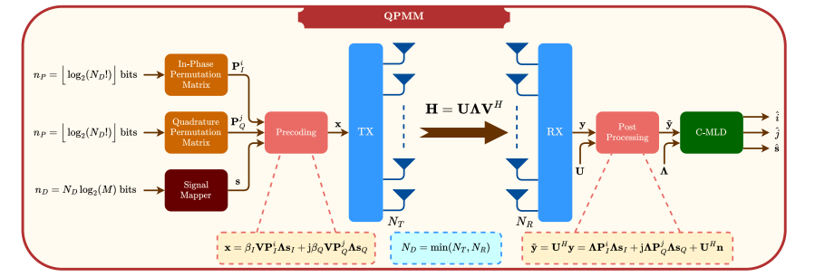
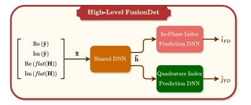
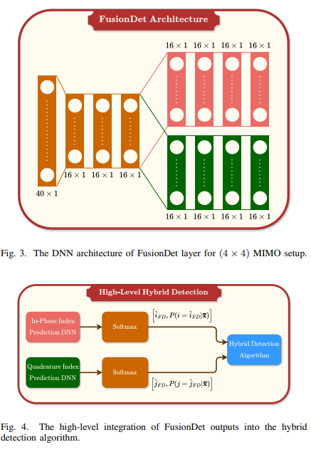
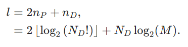
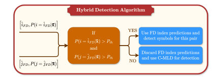
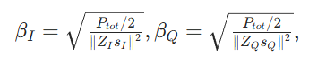
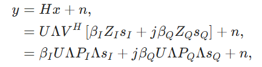
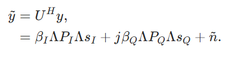
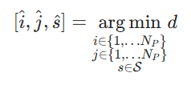
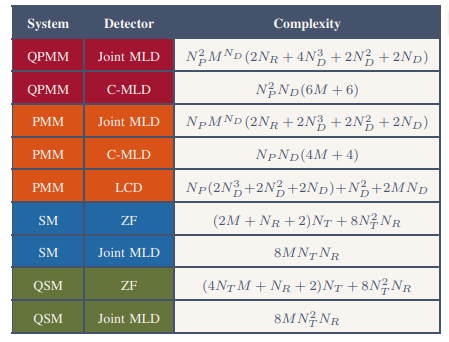
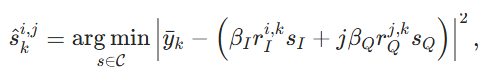
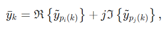
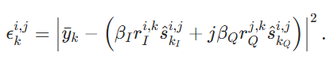
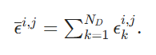
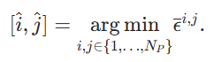
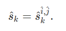
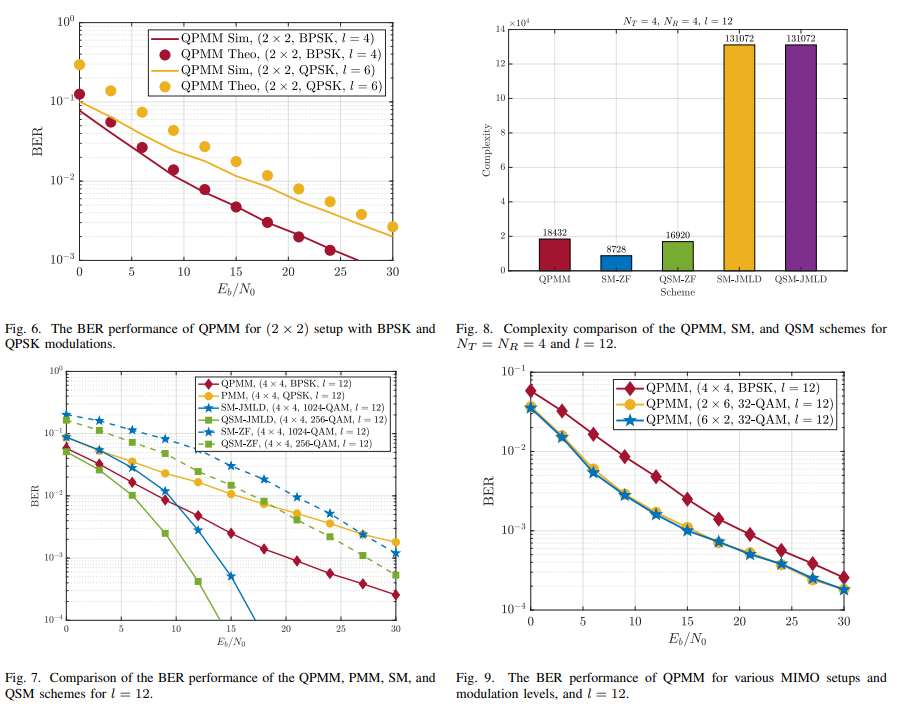
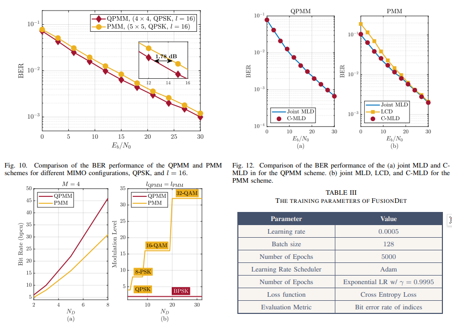
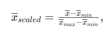
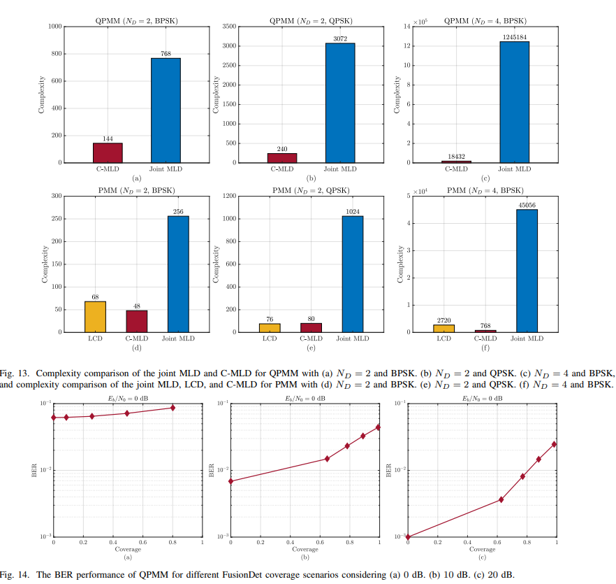
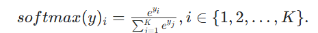
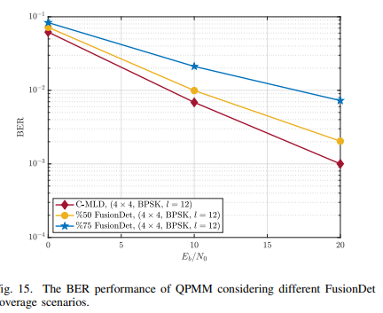

<!-- PAYMENT_BLOCK -->

## Get this dataset

- Payment link (Stripe): [Buy now](https://buy.stripe.com/3cs8yP7sY87d0vu9AB)
- Payment QR code: 

<!-- /PAYMENT_BLOCK -->
